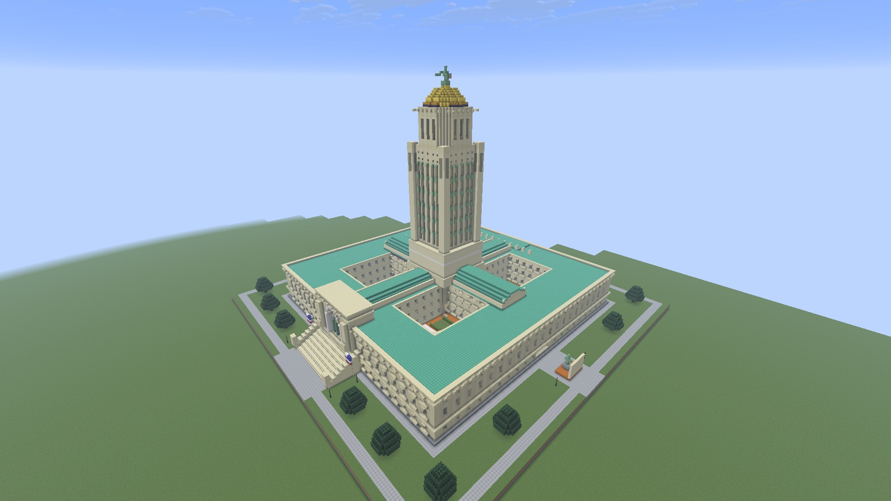

# Minecraft Structure Lab

A NeoForge 26.2 mod and local MCP server for generating NBT structures, placing each revision into a dedicated superflat world, and returning labeled screenshots rendered by Minecraft.

Browse the [build galleries](gallery/README.md), starting with the [Nebraska State Capitol](gallery/nebraska-capitol/README.md): three iterations, 16 final views, and an unmodded Minecraft check.

Version 0.2.0 extends the generate → validate → replace → capture → revise → export loop to large builds. The Nebraska State Capitol example occupies 185 × 130 × 185 blocks and was refined through three real Minecraft capture reviews. It uses one real client camera sequentially. No extra renderer, RCON server, or manual camera cycling is needed.

## Install

Download the JAR and MCP wheel from the [latest release](https://github.com/ewitulsk/MinecraftStructureInjector/releases/latest).

- **[Install the Minecraft mod](docs/INSTALL_MOD.md)** — Modrinth setup, supported versions, and creating the Structure Lab world.
- **[Install the MCP server](docs/INSTALL_MCP.md)** — Python setup, Codex registration, generic MCP configuration, and a first capture.

The tested setup is Windows, Minecraft Java **26.2**, and NeoForge **26.2.0.79**. This release requires NeoForge **26.2.0.77 or newer within Minecraft 26.2**, Java 25 for Minecraft, and Python 3.11+ for MCP. Minecraft and MCP run on the same machine. The JAR alone does not install the MCP server.



[Get the Capitol model, references, placement instructions, and review history](docs/NEBRASKA_CAPITOL.md).

The mod exposes a local HTTP bridge; the external Python process exposes MCP over stdio. Codex or another MCP client starts that process automatically. The bridge creates an ephemeral localhost port and bearer token in `<instance>/structurelab/connection.json`. Keep the connection file private.

## MCP workflow

| Tool | Purpose |
| --- | --- |
| `lab_status` | Read world readiness, origin, resource limits, and active job. |
| `list_blocks` | Query live registry IDs and legal properties. |
| `generate_structure` | Build an NBT using JSON `set`, `fill`, and `room` operations. |
| `generate_example_house` | Generate the furnished example, revision 1 or 2. |
| `validate_structure` | Validate NBT coordinates, palette, registry IDs, properties, and limits. |
| `submit_structure` | Import a file with optional views JSON; replace and capture automatically. |
| `recapture_views` | Capture the current completed structure again, optionally with revised cameras, without clearing or placing blocks. |
| `job_status` / `cancel_job` | Poll or cancel a specific revision. |
| `list_captures` / `get_capture` | List labels and return individual MCP image content. |
| `inspect_blocks` | Read authoritative placed block states. |
| `export_structure` | Copy the clean NBT and package a vanilla 26.2 datapack ZIP. |

Example calls, using absolute paths:

```text
generate_example_house(output_path="D:/builds/house.nbt", revision=1)
validate_structure(path="D:/builds/house.nbt")
submit_structure(path="D:/builds/house.nbt", views_path="D:/builds/house.views.json")
job_status(revision="<returned UUID>")
list_captures(revision="<returned UUID>")
get_capture(revision="<returned UUID>", view_id="bedroom", angle_id="beds")
export_structure(revision="<returned UUID>", output_path="D:/exports/house.nbt")
```

Wait for completion before exporting or submitting another revision. Overlapping submissions are rejected. Old revision IDs are rejected once a new job becomes current.

## Authoring NBT and views

The Python library supports sparse blocks, explicit air, block states, and typed block-entity NBT:

```python
from structurelab import Structure

s = Structure((12, 8, 12))
s.room((0, 0, 0), (11, 6, 11), wall="oak_planks", floor="stone_bricks")
s.set((5, 1, 0), "air")
s.set((5, 2, 0), "air")
position = (5.5, 1, -6)
s.view("spawn", position, [
    {"id": "front", **s.look_at(position, (5.5, 3, 5))}
], spawn=True, label="Front entrance")
s.save("D:/builds/my-house.nbt")
```

Views may be a sidecar JSON list, or embedded `structurelab:view_pad` blocks. `Structure.view(..., pad=(x,y,z))` writes a pad with block-entity metadata. Each pad has a unique ID, label, feet position relative to the structure origin, and ordered angles:

```json
[
  {
    "id": "bedroom",
    "label": "Bedroom",
    "position": [11.5, 1, 6.5],
    "eye_height": 1.62,
    "spawn": false,
    "angles": [
      {"id": "beds", "yaw": -90, "pitch": 10, "fov": 70},
      {"id": "window", "yaw": 0, "pitch": 0, "fov": 70}
    ]
  }
]
```

Minecraft yaw 0 faces +Z, yaw -90 faces +X; positive pitch looks down. FOV defaults to 70 and must be 30–110. Eye height defaults to 1.62 and must be 0–4. Optional `render_distance` is an integer from 4 to 24 chunks on a view; a batch temporarily raises the client distance to the largest requested value and restores the previous setting afterward. IDs must use letters, digits, underscores or hyphens, at most 64 characters. Angle IDs are unique within their view.

For direct NBT authoring, a pad stores the JSON object as the string `nbt.view.json`. If the JSON omits `position`, the camera uses the block center in X/Z and its Y coordinate as feet height. Optional `nbt.view.replacement` is a vanilla palette-style compound with `Name` and optional `Properties`. The default replacement is air. Pad metadata is extracted before placement; pad block entities and unused pad palette entries are stripped from the export. A pad replacement does not preserve a separate block entity.

Mark one view `spawn: true`. Its first angle is captured first and the player returns there after the batch. With no views, an exterior view is generated. With views but no spawn flag, the first view is the return point. An in-game pad configuration screen is not part of this milestone.

## Replacement and capture behavior

- One structure at fixed origin `(0, -60, 0)` above the flat grass layer.
- Each submission is copied into an immutable revision directory before reading. No partial-file watcher races.
- The old/new bounding box is cleared one chunk column per server tick, skipping empty sections. Non-player entities in that box are removed. The template is placed one chunk at a time with native block-entity loading and suppressed incidental placement side effects. Jobs report `clearing` / `placing`, `processed`, and `work_total`.
- Placement temporarily disables pause-on-focus-loss before beginning the chunk batches; capture restores the earlier setting.
- The lab freezes simulation and fixes daylight/weather. This is visual inspection; redstone and mob simulation validation are deferred.
- Before each screenshot, the mod waits for the player/camera position and angles, nearby chunks, lighting work, and section rendering to settle. A view has a 60-second readiness timeout.
- Captures use Minecraft's actual framebuffer at **1920×1080 PNG**, with HUD and view bobbing hidden. A windowed client is resized during the batch and restored afterward. Fullscreen must already be 1920×1080 or the batch reports an error.
- Files use `<view-id>__<angle-id>.png`. The manifest includes revision UUID, input SHA-256, labels, position, yaw, pitch, FOV and image dimensions.
- The previous successful revision remains on disk while a replacement is processed. After a successful replacement, its old revision directory and screenshots are removed. Failed revisions are retained for diagnosis and currently need manual cleanup. Explicit exports and the test evidence folders are never automatically deleted.
- A placement recovery ledger persists the affected bounding box across world reloads. The next submission clears it. This is recovery on the next submission, not transactional rollback to the previous build.

Instance data lives under `structurelab/revisions/<UUID>/`; `structurelab/latest.json` points to the last success. Job polling is in memory: after restarting Minecraft, submit again to make a revision available through MCP.

## Current limits

Limits are explicit resource budgets, not claims that every maximum-size combination has been qualified.

- Width and length: at most 1024 each. Height: at most the world permits; the default lab origin permits **380** blocks through Y=319.
- Bounding volume: **16,000,000 positions**, even for sparse NBT. Combined old/new cleanup bounding volume: **32,000,000 positions**. At most **1,000,000 explicit block records**, 64 MiB compressed input, and a 256 MiB NBT accounting budget. Very different shapes may require a fresh lab world.
- Up to 1024 angle definitions are accepted. Tested examples include the five-angle house and the 429,341-record Capitol with 16 angles at 1920×1080. The full 1024-angle limit and maximum volume have not been performance-qualified.
- One palette; entity templates and multi-palette structures are rejected. Block entities are supported, but arbitrary mod-specific block-entity behavior is not comprehensively validated.
- No disk quota, automatic failed-job pruning, dedicated-server/RCON workflow, or shader compatibility guarantee yet.
- Export removes Structure Lab pads. Builds using other mods retain those dependencies; `export_structure` reports their namespaces. The example exports with no non-vanilla dependencies.

## Vanilla datapack export

`export_structure` writes the requested `.nbt` and a neighboring `.zip` with:

```text
pack.mcmeta
data/lab_export/structure/house.nbt
```

Copy the ZIP into a target world's `datapacks` folder, run `/reload`, then:

```text
/place template lab_export:house 0 -60 0
```

Namespace and name can be changed in the export call. The exported format targets Minecraft Java 26.2, DataVersion 4903, datapack format 107.1.

## Build and install elsewhere

Java 25 and Python 3.11+ are required. This project compiles against NeoForge 26.2.0.77; the actual Modrinth run was on 26.2.0.79.

```powershell
.\gradlew.bat build --console=plain
py -3.13 -m venv .venv
.\.venv\Scripts\python.exe -m pip install -e . pytest
.\.venv\Scripts\python.exe -m pytest -q
```

In a stopped Modrinth NeoForge 26.2 instance, select **Content → Upload files** and choose `build/libs/structurelab-26.2-0.2.0.jar` (not the sources JAR), then launch it and create a Structure Lab world.

See [MCP installation](docs/INSTALL_MCP.md) for release-wheel installation, source installation, and client registration. Set `STRUCTURELAB_CONNECTION` to the absolute connection-file path when running the integration scripts against an instance other than the default Modrinth `NeoForge 26.2` profile.

## Verification

The [Capitol case study](docs/NEBRASKA_CAPITOL.md) documents three large-build iterations. Generate it with `python examples/nebraska_capitol.py --revision 3 --output artifacts/capitol/iteration-3/capitol.nbt`, then run `python scripts/capture_capitol.py artifacts/capitol/iteration-3` with the lab open. Add `--recapture` to exercise camera-only recapture of the current build. These commands replace the active lab structure or its capture set.

With the lab world open, these scripts use real MCP initialization and stdio tool calls:

```powershell
.\.venv\Scripts\python.exe scripts/mcp_probe.py
.\.venv\Scripts\python.exe scripts/verify_milestone.py 1
.\.venv\Scripts\python.exe scripts/verify_failure.py
.\.venv\Scripts\python.exe scripts/verify_milestone.py 2
```

The integration scripts intentionally replace the current lab structure. They generate a furnished house, obtain five images through MCP, inspect block states, and export NBT/datapacks. Revision 2 shrinks the bounds, removes the gold sentinel, and changes blue carpet to red.

Local integration runs save evidence under `artifacts/evidence/v1` and `v2`. These generated files are ignored by Git. The original milestone verification also saved vanilla evidence locally. The vanilla test uses a separate **Structure Lab Vanilla Verification** instance created and launched through Modrinth, with no mods installed. Its log confirms vanilla loaded `lab_export:house`; `vanilla/exterior.png` shows the placed export.

The original local run recorded the installed JAR hash and completed checks in `artifacts/evidence/verification.json`. A portable summary is in [milestone verification](docs/VERIFICATION.md). The failure test verifies that an invalid eye height produces a pollable failed job while preserving the previous world and successful images. Visual review also caught a camera on a wall boundary; the example's kitchen viewpoint was moved into open space and recaptured successfully.

## License

[MIT](LICENSE). This project is not affiliated with Mojang or Microsoft.
