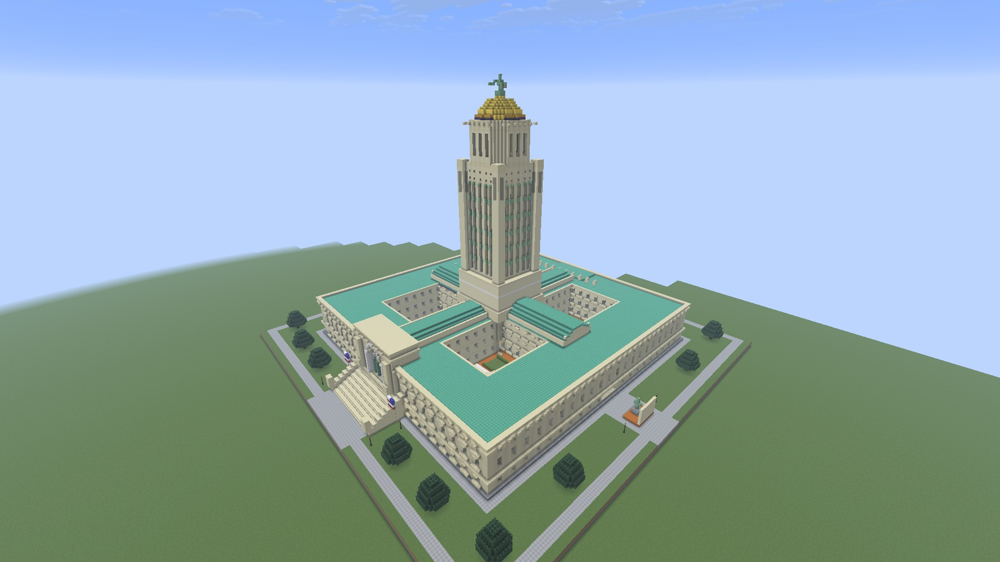
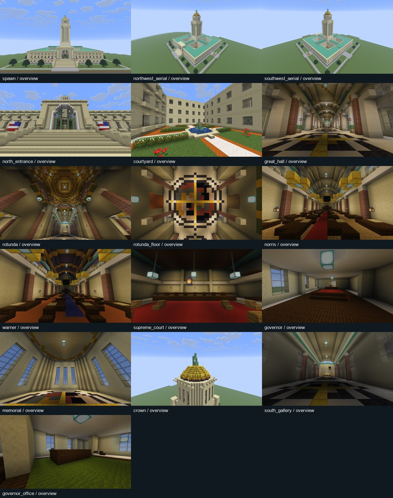

# Nebraska State Capitol — Minecraft scale model

A vanilla-block interpretation of the Nebraska State Capitol for Minecraft Java 26.2. The model uses approximately one block per metre: the building's square base is 133 × 133 blocks, within a landscaped **185 × 130 × 185** structure. The model contains **253,376 non-air blocks** and **429,341 explicit records**, including air that clears interior spaces.

Download `nebraska_state_capitol.nbt` or the ready-to-install `nebraska_state_capitol.zip` datapack from the [v0.2.0 release](https://github.com/ewitulsk/MinecraftStructureInjector/releases/tag/v0.2.0). Structure Lab is not required to load the exported model. It contains only `minecraft:` palette entries and no view pads or entities.



## What is modeled

The square limestone base, four courtyard gardens, axial public halls, narrow tower, upper octagonal Memorial Chamber, blue and gold frieze, gold dome, and Sower establish the building's silhouette. Interiors include the north vestibule and Great Hall, central rotunda and mosaic floor, Norris Legislative Chamber to the west, Warner Chamber to the east, Supreme Court on the south axis, and Governor's Suite in the northeast wing. Repeated offices and tower floors fill out the model.

This is an architectural Minecraft interpretation, not a surveyed reconstruction. Room placement follows the supplied floor map; office partitions, furniture, circulation details, lighting fixtures, murals, mosaics, and sculpture are simplified or interpreted. It does not reproduce every office or original artwork. Sandstone represents limestone, polished granite represents red marble, and waxed copper represents bronze and copper roofs. Screenshots use the actual game renderer without shaders.

## Place the model in vanilla Minecraft

1. Copy `nebraska_state_capitol.zip` into a Java 26.2 world's `datapacks` folder. Leave the ZIP intact.
2. Open a creative world with commands enabled and run `/reload`.
3. Choose a clear 185 × 185 site with 130 blocks of available height. North is negative Z; the placement coordinate is the northwest bottom corner. The first three layers are the model's stone, dirt, and grass foundation.
4. For a default superflat test site at `(0, -60, 0)`, run the commands below. Wait for the forced chunks to load before placing.

```mcfunction
/forceload add 0 0 185 185
/place template nebraska:state_capitol 0 -60 0 none none 1 0 strict
/forceload remove 0 0 185 185
/gamemode spectator
/tp @s 92 -25 -76 0 -7
```

The `strict` argument requests strict placement, preserving authored block shapes while avoiding neighbor-update cascades during the large import. Placement in ordinary Minecraft can pause the game while it processes the template. Adapt all coordinates together for another site. This is a large template; use `/place template` or a compatible mod API instead of the structure-block capture-size controls.

For integration into another datapack, the template is at `data/nebraska/structure/state_capitol.nbt`. The standalone NBT has size `[185,130,185]`, DataVersion 4903, one palette, and an empty entities list. Its namespace/name may be changed when integrating it. Omitted positions remain untouched; place on a cleared site.

## Three iterations, driven by game screenshots

Each iteration was generated as NBT, validated against Minecraft's live block registry, placed in the lab, and captured through MCP. Images were reviewed before the following NBT revision was authored.

| Iteration | Records / non-air blocks | Captures | Review and resulting changes |
| --- | --- | --- | --- |
| 1 | 406,350 / 239,795 | 14 | Established the scale and silhouette. Screenshots exposed incomplete courtyard walls, a floating tower base, dark interiors, and a blocked upper-room camera. |
| 2 | 420,457 / 252,356 | 14 | Enclosed the courtyards, connected the tower, covered the vaults, added useful interior lighting, and cleared the Memorial Chamber. Review prompted refinements to the rotunda, south gallery, office separation, and sculpture. |
| 3 | 429,341 / 253,376 | 16 | Added the south gallery and its camera, separated the Governor's office and captured it, refined the rotunda's lighting and artwork, added flags, and refined the Sower. |



The cameras cover both exterior aerials, the north elevation and entrance, a courtyard, the Great Hall, rotunda ceiling and floor, both legislative chambers, Supreme Court, Governor's reception and office, Memorial Chamber, south gallery, and tower crown. Full-resolution PNGs and manifests are in the release's review bundle. Local working evidence remains in `artifacts/capitol/iteration-1`, `iteration-2`, and `iteration-3`.

## Reproduce or modify the build

Install the repository's Python package, build/install Structure Lab 0.2.0, and open a lab world. Then:

```powershell
.venv\Scripts\python.exe examples/nebraska_capitol.py --revision 3 --output artifacts/capitol/iteration-3/capitol.nbt
.venv\Scripts\python.exe scripts/capture_capitol.py artifacts/capitol/iteration-3
```

The generator also accepts `--revision 1` and `--revision 2`. Each writes an NBT, a camera sidecar, and model statistics. The capture script uses real MCP stdio calls to validate, submit, poll, retrieve PNGs, and export a clean template plus datapack. `--recapture` uses the current completed structure with the supplied camera sidecar and does not place blocks again. Set `STRUCTURELAB_CONNECTION` when using a different Minecraft instance.

## Structure Lab improvements exercised by this build

- Streaming gzip NBT output avoids a second large Python NBT object tree. Typed block entities still round-trip; gzip output is deterministic.
- Clearing and placement operate one chunk column/template chunk per server tick. The old/new bounds are recorded before modification for recovery after an interrupted job.
- Limits now permit 16 million bounding positions and one million explicit records, with a 32-million-position cleanup union. These are budgets; the Capitol exercises 4,449,250 bounding positions, not the maximum.
- Placement reports progress and temporarily disables pause on focus loss. Capture can request up to 24 chunks of render distance and restores the user's previous setting.
- `recapture_views` allows a new labeled screenshot set without reloading the NBT. Normal successful-revision retention applies to recaptures too.

The lab keeps only the latest successful runtime revision after the next success; explicitly exported model files and review evidence are retained. The tested platform was Minecraft Java 26.2, NeoForge 26.2.0.79, Java 25, and Windows. The 1024-angle ceiling has not been load-tested.

The final placement plus 16-view capture took 54.1 seconds; camera-only recapture took 38.0 seconds with zero placement units. A further MCP check compared 184 live positions with the exported NBT, confirmed the ZIP contains exactly that NBT, and verified removal of the previous runtime revision. The Java build and six Python tests passed. A separate unmodded Java 26.2 client also successfully loaded the exported `nebraska:state_capitol` datapack with the native `/place template` command.

## Reference sources

- [Nebraska Virtual Capitol tour](https://nebraskavirtualcapitol.org/tour/capitol/) — exterior entry, Great Hall, rotunda, and legislative chamber panoramas.
- [Nebraska Legislature Capitol map](https://nebraskalegislature.gov/pdf/feature/CapitolMap.pdf) — floor layout and room relationships.
- [Tower and plains](https://nebraskavirtualcapitol.org/overall-building-tower-and-plains/) — 437-foot square base and 400-foot tower proportions.
- [Nebraska Capitol masonry projects](https://capitol.nebraska.gov/masonry-projects/) — limestone, copper roof, gold ceramic dome, and Sower materials.
- [Memorial Chamber](https://capitol.nebraska.gov/building/rooms/memorial-chamber/) — upper octagonal room.
- [Standing Abraham Lincoln sculpture](https://capitol.nebraska.gov/standing-abraham-lincoln-sculpture/) — west-side monument and setting.
- [Archiseek Capitol photographs](https://www.archiseek.com/1932-state-capitol-lincoln-nebraska/) — additional exterior and tower detail reference.

Reference images are linked, not redistributed in the project. The screenshots shown here were captured from the generated Minecraft model.
