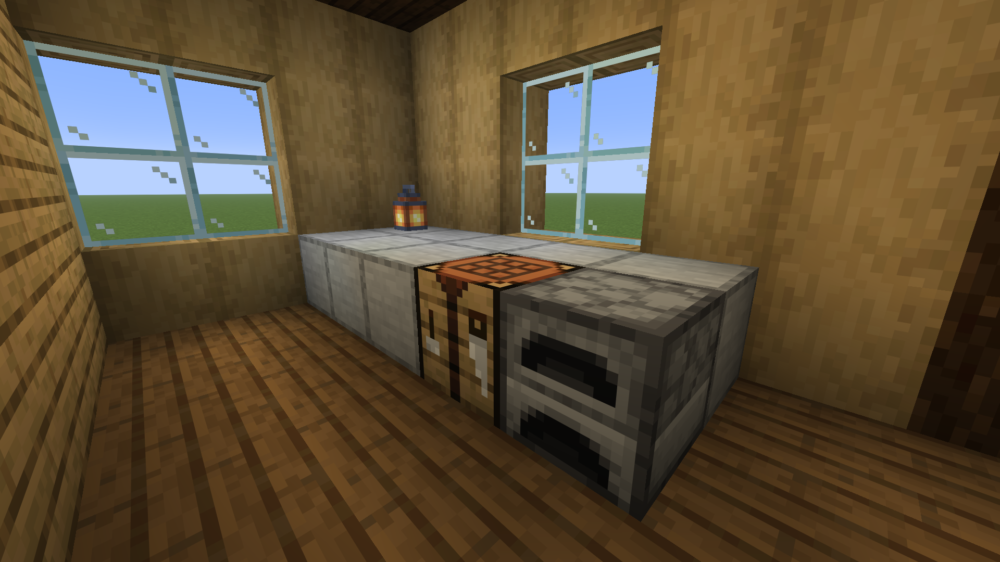

# Milestone 1 verification

Tested September 6–7, 2026 on Windows with Minecraft Java 26.2, NeoForge 26.2.0.79, Java 25, and Python 3.13. The mod compiles against NeoForge 26.2.0.77.

| Check | Result |
| --- | --- |
| Gradle build | Passed |
| Python unit tests | 5 passed |
| Modrinth JAR installation and game launch | Passed |
| MCP initialize, list tools, and actual stdio tool calls | Passed |
| Furnished NBT house generation and registry validation | Passed |
| Automatic capture batch | 5 labeled 1920×1080 PNGs returned through MCP |
| Revision shrinks from 19×10×17 to 17×10×17 | Old gold sentinel removed; blue carpet changed to red |
| Embedded view-pad extraction | Pad becomes air; no Structure Lab palette entries in export |
| Retention | Prior successful revision screenshots removed after replacement completes |
| Rejected camera metadata | Failed job stays pollable; previous world and images preserved |
| Clean export | No non-vanilla block namespaces |
| Vanilla compatibility | Separate unmodded Modrinth 26.2 instance successfully placed `lab_export:house` |

The clean NBT exported by the final run matched the NBT placed in the vanilla instance byte for byte. The installed mod JAR matched the final built JAR.

JAR SHA-256:

```text
e0e4dd89fdba27dd88f7cc41a002617d5b8334d61e86f87e5910a7f0130957dd
```

Visual inspection found a kitchen camera directly on a wall boundary. Moving it half a block into open space removed a clipped corner, demonstrating the capture/review/revise loop:



Large structures and 1024-angle batches have not been performance-qualified. The release retains the 2,000,000-position placement cap and 4,000,000-position cleanup-box cap. The game integration tests are manual/local and require an open graphical Minecraft lab world; they are not headless unit tests.

Run the scripts described in [MCP installation](INSTALL_MCP.md) to reproduce generation, capture, replacement, rejection, and export. Generated evidence remains local under `artifacts/` and is excluded from Git.
