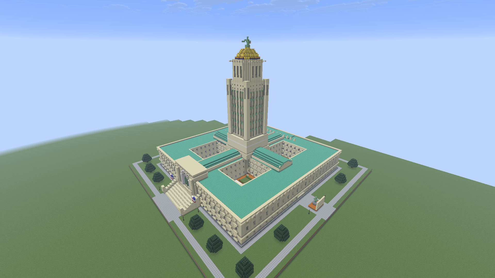

# Build galleries

Minecraft screenshots and visual review notes from builds created with Structure Lab. Each build has its own folder containing its final views, iteration comparisons, and review notes.

## Nebraska State Capitol

[Open the Capitol gallery](nebraska-capitol/README.md) — three iterations, 16 final camera views, and a separate unmodded Minecraft compatibility check.

## Adding another build

Create a folder at `gallery/<build-name>/` with a `README.md` describing the build and linking its screenshots. Keep that build's images and review notes inside its folder, and add a link and preview to this index. Use relative links so the gallery works on any branch.
